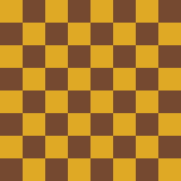
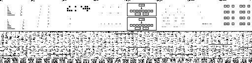
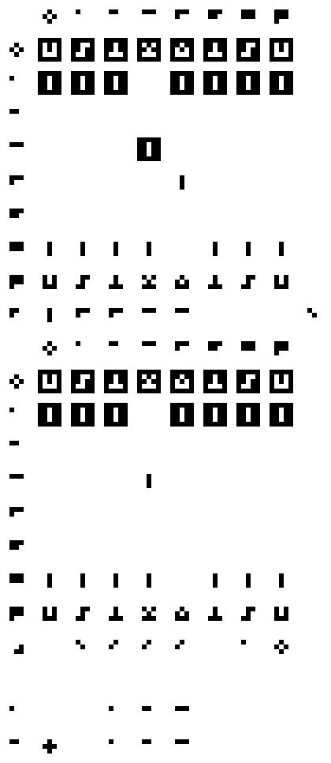

<p align="center">
  
</p>

<h1 align="center">Golden Board</h1>

<p align="center"><i>Why and How to Teach Chess to Aliens</i></p>

## A Note to Human Readers

The README below is a TL;DR overview of the project, providing a high-level understanding of how it works.

I encourage you to read [this illustrated guide](https://artemlegotin.com/golden-board). It walks through every part of the message step by step, explaining how to decode it, from raw bits to more complex structures.

Both the guide and this README were written by me, a person, for other people. So if you're one, they're a good place to start.

That said, the project also has detailed technical documentation containing comprehensive details, better suited for AI-assisted analysis. Feel free to explore the [documentation index](#documentation-index).

Of course, a project this extensive wouldn't have been possible without relying heavily on AI-assisted development. But I can promise that every AI-generated token is backed by my own sweat and tears, with my careful attention at every step. The project took five months to complete, including multiple dead ends and countless redesigns.

I hope you enjoy it.

## What Is It

Golden Board is a self-explaining message designed for an unknown recipient, teaching them how to:
- Decode it from raw bits.
- Learn the rules of chess.
- Explore 64 complete games.

All without assuming any shared language, culture, or prior knowledge of chess.

The recipient only needs to recognize it as a deliberate message, understand basic mathematics, be able to explore patterns, and write simple programs.

Someone with the knowledge and computing tools available to humanity in the 1950s could figure it out.

## How It Looks Like

In a nutshell, Golden Board is a sequence of 4,194,304 ones and zeros – 2^22 bits, or 512 KiB ([download TXT](artifacts/GOLDEN-BOARD.txt) or [binary](artifacts/GOLDEN-BOARD.bin)).

These bits form a square grid of 2048 × 2048 cells ([download PNG](artifacts/GOLDEN-BOARD.png)).

Here's is the fragment, which make up ≈1.5% of the entire message:
<p align="center">
  
</p>

It offers a glimpse of:
- Bootstrap frames (upper strip), which teaches how to decode and read the message. It's chess-agnostic and could be used to decode other structured messages.
- Payload (lower section), which contains the chess lessons, exercises, and games.

[This illustrated guide](https://artemlegotin.com/golden-board) walks through the bootstrap process step by step, explaining how to go from reading raw bits to decoding the entire payload.

## Origins

It inspired by a tradition of messages designed for an unknown intelligence, such as:

- [Voyager Golden Record](https://en.wikipedia.org/wiki/Voyager_Golden_Record)
- [Arecibo message](https://en.wikipedia.org/wiki/Arecibo_message)
- [Cosmic Call](https://en.wikipedia.org/wiki/Cosmic_Call)
- [Lincos (Lingua Cosmica)](https://en.wikipedia.org/wiki/Lincos_language)
- [CosmicOS](https://en.wikipedia.org/wiki/CosmicOS)

But instead of sharing scientific knowledge or works of art, it teaches chess.

## Why Chess

Two reasons:
1. From just a few simple rules, chess opens up an almost limitless world of possibilities, ideas, and beauty.
2. Chess offers something rare – a way to share not knowledge, but a glimpse of the human mind.

## How It Works

Golden Board starts with nothing but a zeros and ones.

By showing simple patterns and examples, it teaches the recipient how to make sense of those bits, turn them into pictures, and gradually discover what they mean.

Each step builds on the previous one, until the message can explain the rules of chess without relying on a single shared word.

## How I Tested It

I tested Golden Board through a series of detailed trials (54 to be precise), using LLMs as a stand-in for an unknown recipient and carefully checking each part of the message separately.

Some raw reconstruction trials began with fresh ChatGPT chats receiving raw bits, without being told they contained chess. Other checks used decoded content, continued context or source/template assistance. The trials tested decoding, interpretation and new applications under these different conditions.

I checked both their decoding and their answers, looking for evidence that they learned from the message rather than relying on what they already knew. The goal was to test whether the message could explain itself.

>[!WARNING]
>Of course, LLMs already know chess, and they are far from perfect stand-ins for an unknown intelligence. I designed the experiments with these limitations in mind, carefully distinguishing successful decoding from genuine understanding. These experiments helped me find ambiguities, challenge my assumptions, and improve the design. None of this guarantees that another intelligence could understand Golden Board, but I wanted to give it the best chance I could. [Read more](docs/guide/trials.md).

## What’s Inside

If you really want to understand how the Golden Board is read and decoded, I encourage you to read [this illustrated guide](https://artemlegotin.com/golden-board).

Golden Board begins with a chess-agnostic bootstrap: a visual guide of 32 frames that starts with counting and simple patterns, then teaches the recipient how to turn raw zeros and ones into meaningful information and read the rest of the message.

Here are the first four frames, which teach counting, binary, and basic patterns:

<p align="center">
  
</p>

Once decoded, the message contains visual lessons teaching chess from scratch: the board, pieces, how they move, special rules, winning and drawing, and basic strategy.

It also includes examples, exercises with feedback, and 64 complete games that the recipient can replay move by move. There are no player names, dates, locations, opening names, annotations, or commentary.

Here's an example of a lesson featuring a pawn capture. While it may look simple and familiar, reaching this point requires decoding and interpreting several layers of the message:

<p align="center">
  
</p>

## Which Games Did I Include

No set of 64 games is complete.

Chess is full of remarkable games. Every game included meant I had to leave out hundreds of other worthy ones.

Since Golden Board includes only the moves, without player names, dates, or events, I chose games for the chess itself: brilliant attacks, surprising sacrifices, clever defenses, quiet strategy, and beautiful endings.

The final anthology ([download PGN](inputs/anthology.pgn)) includes 64 games played between 1909 and 2021 by some of history's greatest chess players. Together, they contain 6,890 individual moves: 39 wins for White, 16 for Black, and 9 draws.

<details>
<summary>List of featured players</summary>

- Mikhail Botvinnik (9 games)
- Vladimir Kramnik (8 games)
- Anatoly Karpov (7 games)
- Garry Kasparov (7 games)
- Veselin Topalov (6 games)
- Levon Aronian (5 games)
- Bobby Fischer (4 games)
- Tigran Petrosian (4 games)
- Viswanathan Anand (4 games)
- Boris Spassky (3 games)
- José Raúl Capablanca (3 games)
- Magnus Carlsen (3 games)
- Mikhail Tal (3 games)
- Akiba Rubinstein (2 games)
- Alexander Alekhine (2 games)
- Alexei Shirov (2 games)
- David Bronstein (2 games)
- Emanuel Lasker (2 games)
- Jan Timman (2 games)
- Lev Polugaevsky (2 games)
- Max Euwe (2 games)
- Paul Keres (2 games)
- Samuel Reshevsky (2 games)
- Vasily Smyslov (2 games)
- Vasyl Ivanchuk (2 games)
- Wolfgang Unzicker (2 games)
- Alfred Brinckmann (1 game)
- Alireza Firouzja (1 game)
- Aron Nimzowitsch (1 game)
- Artur Yusupov (1 game)
- Bai Jinshi (1 game)
- Bent Larsen (1 game)
- Boris Gelfand (1 game)
- Ding Liren (1 game)
- Edward Lasker (1 game)
- Efim Bogoljubow (1 game)
- Efim Geller (1 game)
- Erich Eliskases (1 game)
- Frank James Marshall (1 game)
- Hans Berliner (1 game)
- Hans-Joachim Hecht (1 game)
- Henrique Mecking (1 game)
- Ian Nepomniachtchi (1 game)
- Judit Polgar (1 game)
- Karthikeyan Murali (1 game)
- Lazaro Bruzon Batista (1 game)
- Ljubomir Ljubojevic (1 game)
- Mark Taimanov (1 game)
- Michael Adams (1 game)
- Nigel Short (1 game)
- Nikolay Minev (1 game)
- Paul Johner (1 game)
- Peter Leko (1 game)
- Rashid Nezhmetdinov (1 game)
- Savielly Tartakower (1 game)
- Semyon Furman (1 game)
- Svetozar Gligoric (1 game)
- Ulf Andersson (1 game)
- Viktor Korchnoi (1 game)
- Wei Yi (1 game)
- Yakov Estrin (1 game)
- Yuri Averbakh (1 game)
</details>

## What Is It All For?

There is a special joy in sharing something you love.

But what could we share with someone who knows nothing about us?

If we ever reach another civilization, we could send our scientific discoveries or our greatest works of art. But science might tell them things they already know, and art might lose its meaning without the culture behind it.

Chess offers a different kind of gift.

We can teach its rules from scratch, then let another mind explore a world shaped by centuries of human imagination – our ingenuity, ambition, mistakes, sacrifices, and moments of brilliance.

<p align="center">***</p>

Most likely, no one will ever receive this message.

But even the smallest chance that someone, somewhere, might discover a position in which [Bf5 is played](https://www.youtube.com/watch?v=Pv5jbBd2Ezk&t=402s) and find in it what we did – makes the whole thing worth trying.

I wish I could see their reaction.

## Build on It

Golden Board isn't just about chess. It's also an attempt to solve a much broader problem: how to teach something to someone who shares none of our language or culture.

The provided bootstrap is chess-agnostic and could be used to decode other structured messages.

For developers, the project offers a starting point for building similar messages. Its binary format and Python build tools can be studied and adapted to teach something entirely different.

For researchers, the tests and LLM trials offer a way to investigate what works, what fails, and why. Try another subject, another model, or a different approach to explaining ideas without words.

I'd love to see what you can build from here.

With Python 3.14 and Node 22 installed:

```sh
python3.14 gb setup --offline
./gb verify
./gb check fast
./gb reproduce --output build/reproduced
```

## License

Golden Board's original message, images and documentation are free to share, study, modify, and build upon for noncommercial purposes, with attribution. Commercial use of this material requires prior written permission from the copyright holder (me).

- **Code:** [MIT License](LICENSE), which permits commercial use.
- **Message and content:** [Creative Commons Attribution-NonCommercial 4.0](LICENSE-CONTENT.md)

Please credit [Artem Legotin](https://artemlegotin.com/) and link back to this project when sharing or adapting it.

```bibtex
@misc{golden_board,
  author = {Legotin, Artem},
  title = {{Golden Board}},
  url = {https://github.com/arlegotin/golden-board}
}
```

## Documentation Index

If you'd like to dive into the detailed technical documentation, start here:

- [Entry point](docs/README.md)
- [Guide](docs/guide/README.md)
  - [Origins](docs/guide/origins.md)
  - [Message](docs/guide/message.md)
  - [Artifacts](docs/guide/artifacts.md)
  - [Bootstrap](docs/guide/bootstrap.md)
  - [Format](docs/guide/format.md)
  - [Lessons](docs/guide/lessons.md)
  - [Games](docs/guide/games.md)
  - [Game Index](docs/guide/game-index.md)
  - [Architecture](docs/guide/architecture.md)
  - [Trials](docs/guide/trials.md)
  - [Decisions](docs/guide/decisions.md)
  - [Build](docs/guide/build.md)
  - [Distribution](docs/guide/distribution.md)
- [History](docs/history/README.md)

---

<p align="center">
  
</p>
