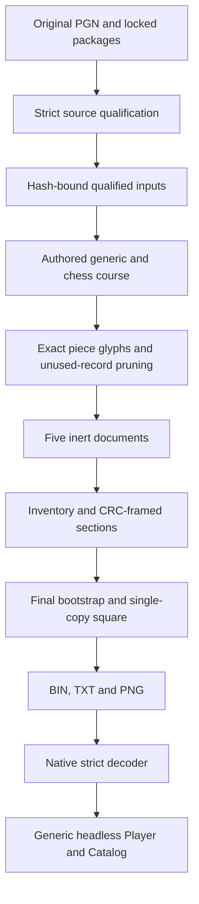

# Architecture and machinery

Golden Board uses one production Python authoring/build pipeline, an explicitly
bounded chess adapter, narrow independent checks and a generic JavaScript document
mechanism. Chess calculations happen while authoring and verifying the message.
The recipient's generic mechanism follows records already inside it.

## Source, authoring and verification boundaries

[source.py](../../src/golden_board/source.py) validates the exact PGN against
its lock and accounts for record boundaries. [source_game.py](../../src/golden_board/source_game.py)
implements the strict main-line import profile: standard start, concluded matching
score, valid minimal SAN and no silently skipped syntax. [anthology.py](../../src/golden_board/anthology.py)
classifies every original record, validates complete legal histories and preserves
selected membership before sorting canonical game content. It does not use player
names or dates to determine message bytes.

[rules.py](../../src/golden_board/rules.py) wraps pinned chess 1.11.2. It separates
control from legal movement, occupancy from rights/history, opportunities from
accepted claims, and active games from explicit closure. The independent
[original-SAN reference](../../tests/reference-anthology.mjs) uses pinned chess.js,
not the coordinate moves emitted by Python. Their comparison includes every ply,
with the explicit en-passant FEN projection described in [games](games.md).
Hand-derived fixtures protect boundaries where both packages could share a mistake.

The production library has a broader API than the message's practical profile.
Only the adapter's declared outcomes belong to the course. There is no general
unwinnability solver and no engine evaluation. See [the exact profile](../../spec/chess.md)
and [predicate definitions](../../spec/predicates.md).

## Course construction

[CourseAuthor](../../src/golden_board/course_author.py) allocates records in one
ID space, interns identical frames and glyphs, builds sparse literal updates,
and emits practice/feedback/passive routes. It validates references and finite
routes. Identical data may be shared through record references; this is different
from duplicating payload units for fault recovery.

The four course builders partition the retained obligations:

| Builder | Main supporting machinery | Output |
|---|---|---|
| [course_generic](../../src/golden_board/course_generic.py) | course_author | Representation, arithmetic, indexing, references and actions |
| [course_foundation](../../src/golden_board/course_foundation.py) | authoring, qualified foundation input, rules | Board, identities, movement and king safety |
| [course_practical](../../src/golden_board/course_practical.py) | practical_cases, practical_state, history_segments | Rights, special moves, history, endings and records |
| [course_advanced](../../src/golden_board/course_advanced.py) | advanced_cases/state/fixtures, rehearsal_predicates | Exact relations, mating, guidance and anthology use |

`*_cases` specifies finite examples and queries; `*_state` evaluates declared
facts against coherent legal state. [history_segments.py](../../src/golden_board/history_segments.py)
shares literal prefix segments and adds explicit boundaries and continuations.
It does not run chess inside the recipient mechanism. [course_move_packing.py](../../src/golden_board/course_move_packing.py)
authors the explanation of move fields. [rehearsal_predicates.py](../../src/golden_board/rehearsal_predicates.py)
remains active despite its historical name: the advanced course uses these exact
predicate checks. The complete inventory is [coverage.toml](../../content/coverage.toml).

[piece_glyphs.py](../../src/golden_board/piece_glyphs.py) applies the final 5×5
piece masks and colour complements. [message_cleanup.py](../../src/golden_board/message_cleanup.py)
removes only unused glyph definitions and specified unused metadata. It preserves
semantic zero values, record IDs, actual frames and feedback. These are established
steps in final generation, not release-preparation edits to the board.

## Anthology and qualified derivatives

[authoring.py](../../src/golden_board/authoring.py) builds generic game pictures and
literal every-ply updates. [anthology_playback.py](../../src/golden_board/anthology_playback.py)
checks those frames against qualified legal truth. [shared_anthology.py](../../src/golden_board/shared_anthology.py)
shares repeated record structures. [move_packing.py](../../src/golden_board/move_packing.py)
stores each origin/destination/promotion in a checked 6/6/3-bit value.

The current builder deliberately imports three historically qualified derivatives:

| Retained file | Why it remains necessary |
|---|---|
| [Foundation document](../../evidence/S03-selective-carrier/actual-rehearsal/documents/3.bin) | Exact inherited foundation subgraph, with a permitted pinned header conversion |
| [Shared anthology](../../evidence/S03-shared-anthology/actual-document.bin) and [receipt](../../evidence/S03-shared-anthology/actual-summary.json) | Complete qualified game/presentation data before deterministic packing and current glyph/grammar conversion |
| [Source qualification](../../evidence/S04-rules/actual-source.json.gz) | Full original-source truth, every-ply states and code-bound qualification identities |

These paths remain under `evidence/` because unchanged qualified code names them.
They are required build inputs, not disposable reports. [anthology_input.py](../../src/golden_board/anthology_input.py)
and [advanced_fixtures.py](../../src/golden_board/advanced_fixtures.py) check their
hashes and dependencies before use. Exercise continuations in advanced_fixtures
are explicitly authored tails, never additions to a historical game.

[qualified_inputs.py](../../src/golden_board/qualified_inputs.py) permits one header
conversion only for two exact hashes. Historical presentation receipts bind the
old codec/player and original presentation source bytes. Those originals now live
in [inputs/qualified](../../inputs/qualified/manifest.json); their original path
keys remain historical receipt identities. They are never imported as runtime.
Moving the active headless imports did not requalify the old receipts: it preserved
their original inputs and added full output regression checks.

This is reproducibility from surviving exact inputs, not a claim that the modern
build recreates every old research step. The retained source qualifier and game
authoring functions let maintainers investigate or rebuild derivatives explicitly.
They must produce new receipts rather than silently replacing accepted inputs.

## Transport and raster

[clean_build.py](../../src/golden_board/clean_build.py) assembles the documents,
checks complete coverage, invokes actual Node frame/action audits, constructs six
sections and emits the complete capacity ledger. [document.py](../../src/golden_board/document.py)
encodes/decodes five inert record types. [clean_carrier.py](../../src/golden_board/clean_carrier.py)
checks section identity/order/length/CRC, inventory, document references and zero
reserve. It searches clean orientations/polarities and requires unique extraction.

[direct_bootstrap.py](../../src/golden_board/direct_bootstrap.py) connects the carrier
to the final [bootstrap_clarity.py](../../src/golden_board/bootstrap_clarity.py)
composition. [raw_draw.py](../../src/golden_board/raw_draw.py) supplies exact binary
panel primitives and the miniature. [checksum.py](../../src/golden_board/checksum.py)
provides CRC-32C. [raster.py](../../src/golden_board/raster.py) writes deterministic
one-bit PNG images; it is artifact-generation machinery.

There is one payload placement, no replicas, voting, ECC or guessed restoration.
The name `clean` marks the explicitly chosen observation contract, not a promise
that corruption is repaired. The [format chapter](format.md) gives actual fields.

## Generic headless mechanism

[mechanism/player.mjs](../../mechanism/player.mjs) decodes records, seeks literal
updates, performs select/commit/reset/link operations and can render an SVG frame.
[Catalog](../../mechanism/catalog.mjs) opens only carried document roots.
[relay](../../mechanism/relay.mjs), [catalog-relay](../../mechanism/catalog-relay.mjs)
and [passive](../../mechanism/passive.mjs) export mechanical actions and complete
passive routes. They contain no chess dependency, move generator, answer service
or domain-specific inference. Accepted practice responses are carried data.

These modules were moved byte-for-byte from the former interface directory.
The browser interface and its dedicated packaging are outside the current source
tree.
Generic SVG generation remains useful as an inspection primitive. It is not a
supported browser application. [Build](build.md) shows the headless interfaces.
