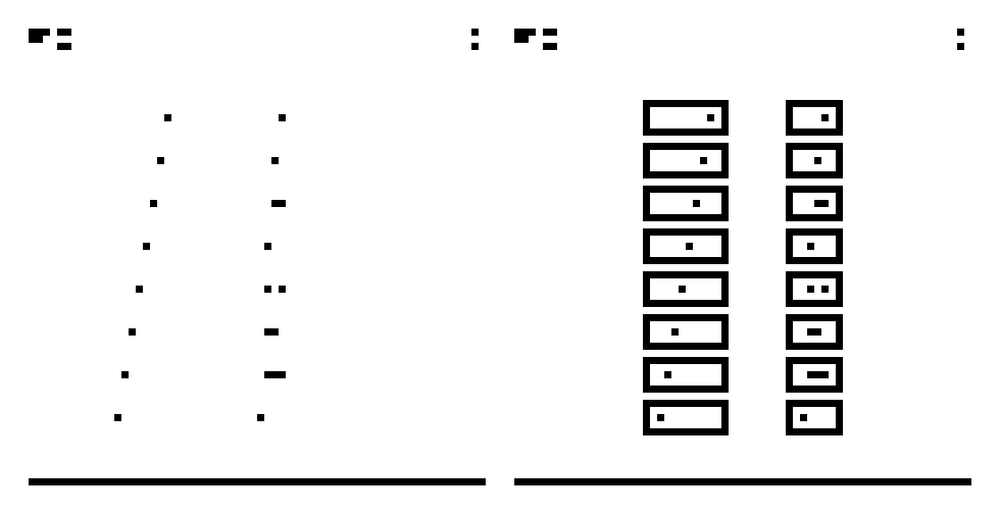
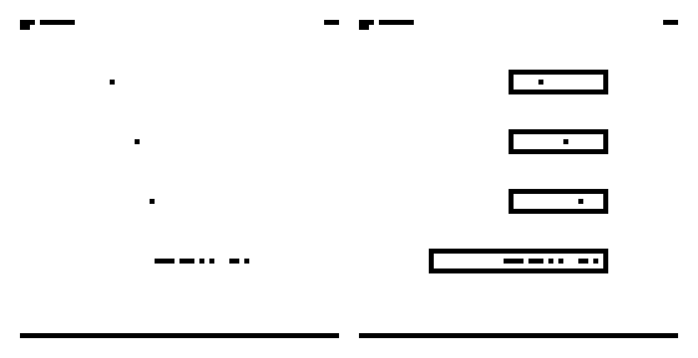
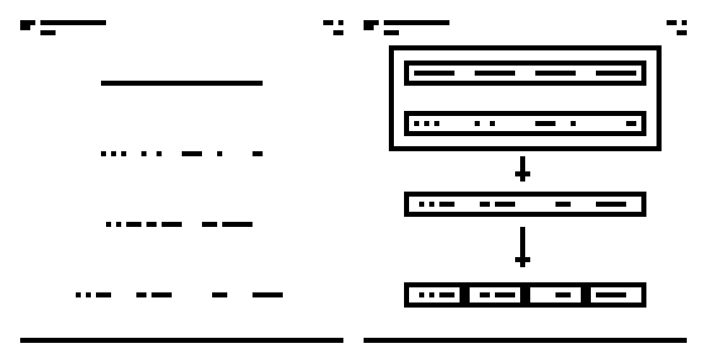
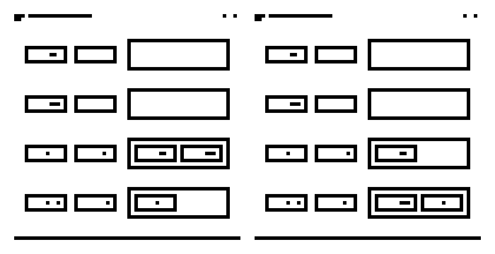
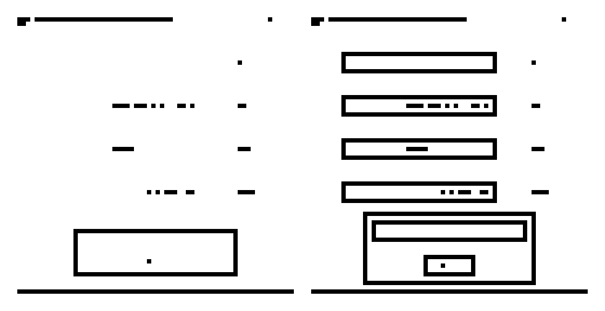

# Bootstrap field-boundary candidate

`bootstrap-field-boundaries-1` is a separately identified drawing candidate. The
canonical [bootstrap](bootstrap.md), PNG/TXT/BIN and default reproduction remain
unchanged. The candidate changes 11 of the 32 panels; all payload bytes, section
checks, document bodies and reserve bytes remain exact.

The design applies the retained [field-window findings](../history/experiments.md#field-windows-and-composed-prerequisites):
correct values do not by themselves establish field boundaries, especially when
zero edge bits disappear into white space. Those findings inform this layout;
historical recipient results remain bound to their original observations. Native
construction and regression checks do not establish recipient comprehension.

## Field convention

Numerical field boxes use the same inset as the existing bounded byte examples:
one white cell separates the data from the border on each side. Box positions and
widths account for every bit, including leading zeros, trailing zeros and entirely
zero fields. The boxes describe diagram fields; they are not additional payload
bits or a change to the section/document grammar.

The XOR diagrams share an operand group followed by a downward result arrow.
Words are shown as four eight-bit bands. Their all-ones operand exposes every
band's extent. In panel 13 the result's bands align directly with four individually
boxed output bytes, preserving most-significant-byte-first order.

## Principal comparisons

Each comparison shows the canonical panel on the left and the candidate on the
right. Images enlarge exact cells without labels inside the panels.

### Panel 2: centred bit-position columns

The eight-bit values and four-bit positions have fixed boxes. The combined block
has equal outer margins, independent of which bits happen to be black.



### Panel 7: a shared least-significant-bit position

The side, starting row and bits-per-byte quantities retain their 16-bit widths;
the used-byte count retains 32 bits. All four numerical fields end at the same
column, and their boxes show where trailing zeros stop.



### Panel 13: operands, result and byte representation

The first two rows are the final XOR's inputs; the next row is its result. The
last row contains the same bits as four bytes, aligned with the result's bands.
Panel 11 introduces the same calculation layout before the worked CRC steps.



### Panel 18: zero, one and two references

Objects 6 and 7 have no references. Object 8 refers to 6; object 9 refers to 7 and
8. Counts progress through 0, 0, 1 and 2. Every target appears before its use,
including the reference to an object that itself contains a reference.



### Panel 32: blank data and its width

The upper numerical fields have explicit 32-bit bounds, including the all-zero
first field. The lower example encloses its 32 zero cells separately from the
eight-bit width label `00100000`.



## Other affected panels

| Panel | Drawing change |
|---|---|
| 6 | Bound the 16-bit number and both eight-bit halves, including zero bytes. |
| 9 | Bound each shift operand/result and the discarded bit, including a discarded zero. |
| 10 | Bound 32-bit and 33-bit representations with a common least-significant-bit column. |
| 11 | Introduce the operand-group/result layout used in panel 13. |
| 14 | Bound each source byte and each computed/stored 32-bit check. |
| 19 | Bound the checked/stored range diagrams and the computed 32-bit check. |

The complete sheets show panels [1–8](images/bootstrap-boundaries/bootstrap-01-08.png),
[9–16](images/bootstrap-boundaries/bootstrap-09-16.png),
[17–24](images/bootstrap-boundaries/bootstrap-17-24.png) and
[25–32](images/bootstrap-boundaries/bootstrap-25-32.png).
[Image source identity](images/bootstrap-boundaries/source.json) binds the pictures
to the complete candidate and records the comparison order and unchanged payload.

## Reproduce and inspect

Use the existing builder and renderer with an explicit profile and fresh outputs:

```sh
./gb build --bootstrap field-boundaries --output build/bounded-candidate
python3.14 tools/render-guide-images.py --bootstrap field-boundaries \
  --source build/bounded-candidate/GOLDEN-BOARD.bitplane \
  --output build/bounded-candidate-images
./gb check focused carrier
./gb verify
```

The ordinary build and `reproduce` commands retain the canonical layout by
default. Native candidate decoding requires the explicit
`bootstrap=golden_board.bootstrap_boundaries` module argument to
`clean_carrier.decode_symbols` or `decode_serial`. Each profile accepts only its
complete exact route: there is no layout autodetection, recovery or guessing.
The build report identifies the candidate layout, source hashes and canonical
identity comparison; `release_ready` remains false. These commands run local
construction, native checks and rendering, with no recipient-trial entry point.
