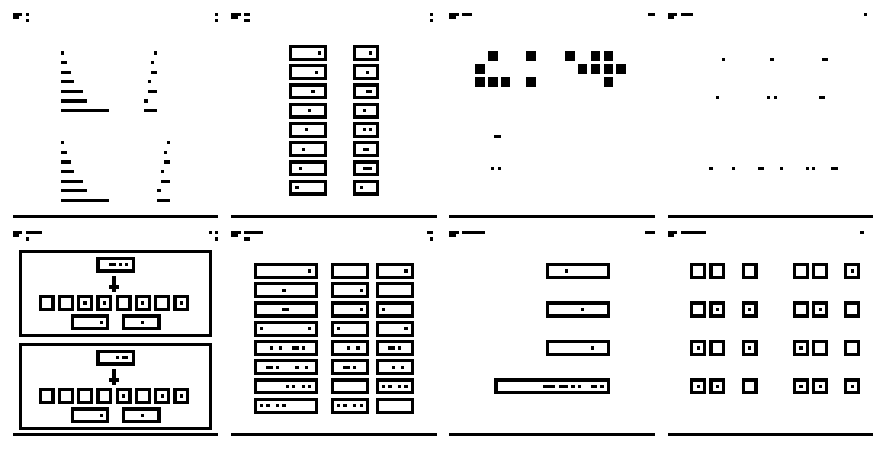
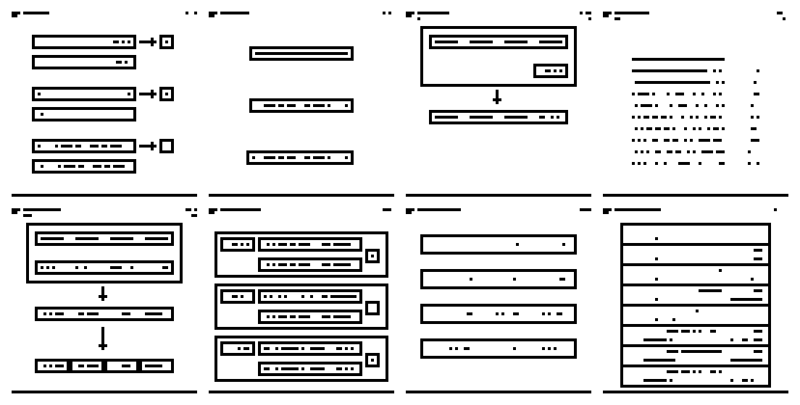
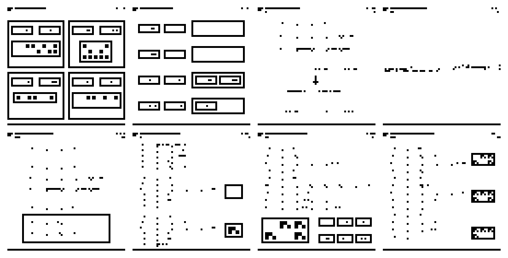
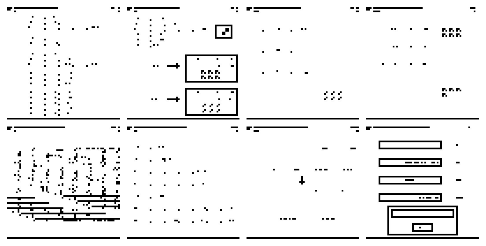

# The bootstrap

The recipient starts without bytes, field names or a chess alphabet. The
bootstrap has to establish those conventions through visible examples.

Its 32 panels occupy one strip across the top of the square. Repeated corner
marks, panel numbers and bottom lines give the strip a consistent direction.
Each header pairs a unary count with a binary panel number at the right edge.
Smaller counters beneath them number the steps within a related group; standalone
panels omit that second counter. Counting comes first; the same numbers then appear in dimensions, lengths,
addresses and references. Later panels use conventions demonstrated earlier.

The images below show the actual cells, enlarged four times. Each group is laid
out left to right, then top to bottom for reading here. In the artifact all 32
panels stay in one row. [Open the complete strip](images/bootstrap-clarity/bootstrap-strip.png).

The images contain the artifact's exact 64 × 64 panels with white gutters between
them. No corner digits or other guide labels are added. The tables below identify
the panels; the unary and binary counts within each panel belong to the message.

Bounded numerical fields leave one white cell between their data and the border.
The bounds include leading zeros, trailing zeros and entirely zero fields. A
single-bit field uses the same empty-or-central-dot box in the truth tables,
discarded-bit examples and checksum verdicts.

## 1–8: quantities become fields

| Panel | What the diagram shows |
|---|---|
| 1 | Eight counting examples: 0, 1, 2, 3, 4, 7, 8 and 15. The upper block writes them in four bits; the lower block adds four leading zeros. Unary stripes connect quantities to both widths. |
| 2 | The eight single-bit values and their places in a byte, in fixed bounded columns. |
| 3 | A 3 × 5 pattern and its complement, with the two dimensions. |
| 4 | A small numbered grid beside its linear sequence: row order. |
| 5 | Bytes 53 and 11 expanded into eight individual cells. |
| 6 | Bounded two-byte numbers split into high and low bytes, including zero bytes: byte order. |
| 7 | The actual square side, payload starting row, bits per byte, and used-byte count, with a common least-significant-bit column. |
| 8 | Complete two-input XOR and equality examples. |

Panel 1 preserves the carry boundaries at 3→4 and 7→8, and the largest four-bit
value. The two widths express the same quantities. A leading zero changes the
field's width, not its value.

## 9–16: checking and locating data

| Panel | What the diagram shows |
|---|---|
| 9 | Bounded right shifts and the bit that falls off the end, including a zero. |
| 10 | Bounded 32-bit and 33-bit CRC polynomial representations aligned at their low end. |
| 11 | Two grouped operands, the initial 32-bit state and a byte, followed by their XOR result. |
| 12 | Every intermediate state while processing byte 53. |
| 13 | Two grouped operands followed by the final XOR result, then the same bits in four aligned byte boxes. |
| 14 | Bounded computed/stored checks with the same single-bit equality verdicts taught in panel 8. |
| 15 | Four section components, each shown as start, length and end: ID, length field, body and check. |
| 16 | Payload byte/bit addresses paired with square row/column addresses. |

This teaches a particular checksum procedure, including its starting state and
final operation. Naming a familiar checksum would not establish those choices
for an unknown reader. The worked intermediate states make the procedure visible.
Panel 13 combines 32 one-bits with the final state from panel 12. The result below
them is the checksum. Its four eight-bit bands align with the four output bytes
on the last row, preserving most-significant-byte-first order.

## 17–24: references become pictures

| Panel | What the diagram shows |
|---|---|
| 17 | Matrices with several dimensions, including a zero-valued row. |
| 18 | Independent objects 6 and 7; object 8 refers to 6, and object 9 refers to 7 and 8. Reference counts progress through 0, 0, 1 and 2, with every target shown before its use. |
| 19 | The miniature's actual header/check fields, the covered range and the range storing the check. |
| 20 | The miniature inventory as complete carried bits. |
| 21 | That inventory separated into counts, lengths, checks and entry references. |
| 22 | A document header, then blank glyph 0 and patterned glyph 1, each beside its encoded definition. Both have two rows and three columns. |
| 23 | A frame record that places those glyphs in a grid of two rows and three tiles, with cell addresses 0–5. |
| 24 | An initial frame and two partial updates, beside their resulting pictures. |

An ID points to a record. It is not the record's length or its location in the
file. Panel 18 keeps each object and its whole reference list together. Panels
22–24 then define small pictures, assemble them and change individual cells.

## 25–32: a complete reading example

| Panel | What the diagram shows |
|---|---|
| 25 | A page's display, response choices, accepted response and navigation references. |
| 26 | Contrast glyph 2, then two worked responses leading to their feedback pages and displayed frames. |
| 27 | Selecting, resetting and committing in the miniature exercise. |
| 28 | Feedback and passive-route outcomes. |
| 29 | The complete miniature document inside its checked section. |
| 30 | A numeric table's kind, ID, length, dimensions and values. |
| 31 | Inventory followed by document section: offsets, lengths, order and end boundary. |
| 32 | Used bytes, total capacity and zero-filled reserve. |

Glyph 1 is `110 / 101`; contrast glyph 2 is `001 / 010`. The contrast's white
first column is part of its width, even though its black pixels look narrower.
The small example in panel 32 separately boxes a row of 32 zero bits and the
eight-bit number `00100000` beneath it. The number labels the example's width;
its own box identifies the complete eight-bit field.

The miniature is a complete 326-byte document about a six-cell picture. Its three
glyphs, frames, updates, table, exercise and feedback are all present. The reader
can follow a small example from raw cells to an action's visible result before
applying the same grammar to the payload.

The strip also carries its own used-byte count. Once the inventory and five
documents have been read and checked, the rest of the square must be zero reserve.

Next: [the document format](format.md).

Exact references: [current panel authoring](../../src/golden_board/bootstrap_clarity.py),
[carrier entry points](../../src/golden_board/direct_bootstrap.py),
[drawing primitives](../../src/golden_board/raw_draw.py).
